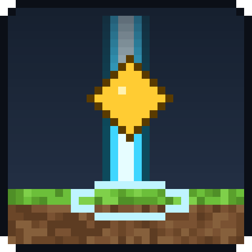
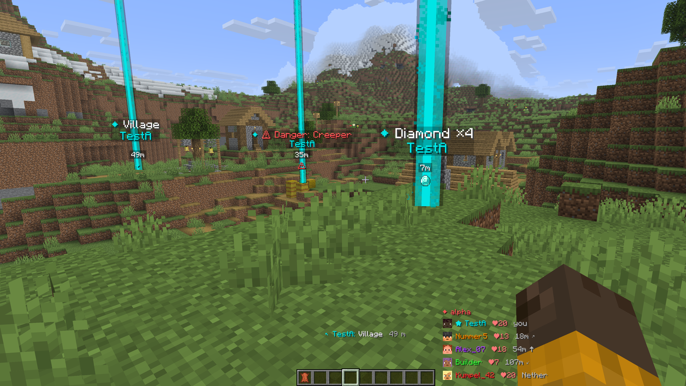
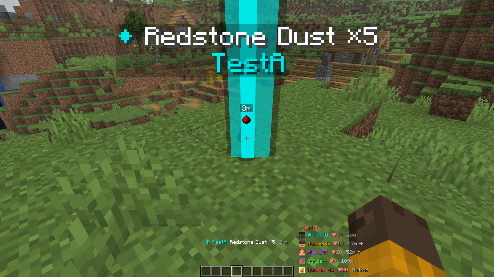
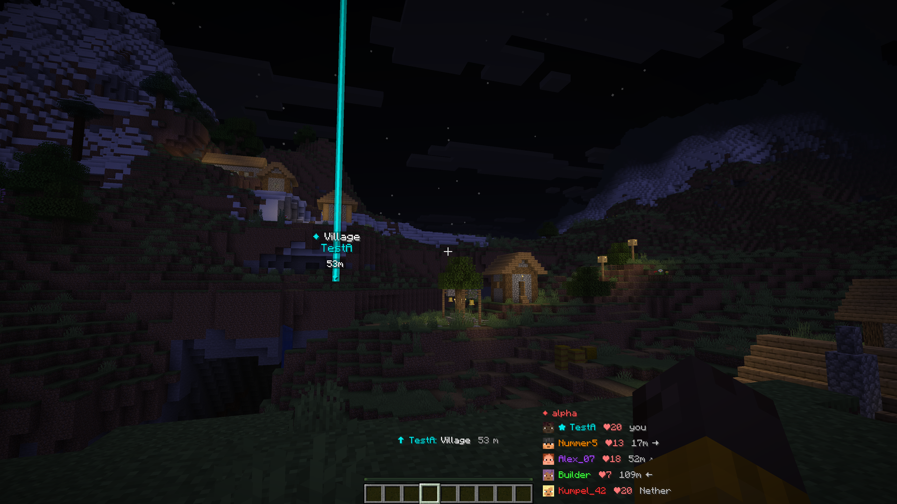
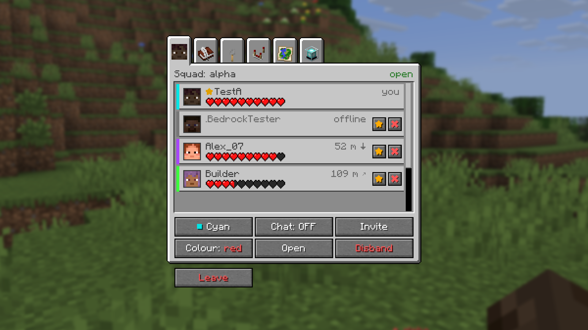
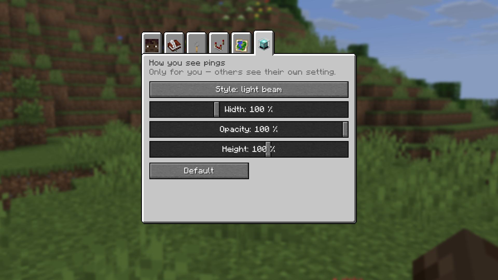

<p align="center"></p>

<h1 align="center">TeamPing</h1>

<p align="center"><b>Squads and Apex-style pings for your Minecraft server, for Java <i>and</i> Bedrock players, with or without a client mod.</b></p>

---

TeamPing lets players form a **squad** and **mark places, mobs, items and danger** for their teammates. A glowing beam shows each ping, and you can see it through walls. It also shows where everyone in your squad is. Java and Bedrock players can play together on the same server through Geyser/Floodgate.

The project has two parts:

| Part | Where it runs | Required? |
|---|---|---|
| **TeamPing** (`plugin/`) | Paper server | yes |
| **TeamPing Companion** (`mod/`) | Fabric client (Java) | no, optional extras for Java players |



| | |
|---|---|
|  |  |
|  |  |

## Features

### Server plugin (works without any client mod)
- **Squads**: create, invite, open/closed, leader, team colours, squad chat (`/sc`), overview of health and distance
- **Pings**: a glowing beam (visible through walls) with a label such as *Village*, *Diamond ×3* or *⚠ Danger: Creeper*
  - up to **3 pings** per player (6 s) plus **one map ping** (30 s). All of this can be configured.
  - ping **items**: the ping follows the item and ends when someone picks it up
  - ping **through glass**. Ping **mobs and players** and the marker follows them.
  - **danger pings** (ping twice quickly; hostile mobs are marked automatically), **"over here"** (look up), **death point** for your squad
  - **directional sound**, so you hear where the ping is
  - structure names (village, outpost, …) and block names, in English and German (follows the player's game language)
- **Bedrock players get full support**
  - squad menus in native Bedrock style (tabs, member rows, health and distance)
  - ping with an **emote**. Different emotes can do different ping types.
  - a custom **light beam** block and a squad overview box on the HUD. The resource packs are **installed into Geyser automatically**.
- Ways to ping on Java without the mod: sneak + F, F, sneak + Q, sneak + left click, double sneak, `/ping`, a ping item. Each player picks their own in `/squad controls`.

### Companion mod (Fabric, optional)
- **Markers right on the target** (visible through walls), plus **arrows at the screen edge** for pings out of view
- **Item icons** on item pings. Names are shown while you hold Tab.
- **Far pings**: aim further than the server can see, or into **Distant Horizons** terrain (up to 4 km). The beam is drawn at the real spot.
- **Your own ping style**: light beam or dot only, with your own width, opacity and height
- squad overview HUD, squad window with tabs, free key bindings (default: **Z** = ping, **G** = menu)
- **Xaero's World Map**: middle click or double click on the map pings that spot
- settings in game (Mod Menu) or in `config/teamping.json`

## Installation

### Server
1. Install **Paper 26.3**.
2. Put `TeamPing-<version>.jar` into `plugins/` and start the server. This creates `plugins/TeamPing/config.yml`.
3. *For Bedrock players:* install **Geyser** and **Floodgate**. Set `auth-type: floodgate` in Geyser's config as usual. TeamPing puts its resource packs into `plugins/Geyser-Spigot/packs/` and its block mapping into `plugins/Geyser-Spigot/custom_mappings/` by itself when the server starts, so you don't need to restart. Keep Geyser's `force-resource-packs: true` (the default).

### Client (optional)
Install **Fabric Loader 0.20+** and **Fabric API** for Minecraft 26.3, then put `teamping-companion-<version>.jar` into `mods/`.
Optional: Mod Menu, Xaero's Minimap/World Map, Distant Horizons.
The mod only does something on servers that run the TeamPing plugin.

## Commands

| Command | |
|---|---|
| `/squad` | open the squad menu (chest menu on Java, form on Bedrock, window with the mod) |
| `/squad create <name> [colour]` · `join <name>` · `accept <name>` · `leave` | join or leave squads |
| `/squad invite <player>` · `kick <player>` · `leader <player>` · `color <colour>` · `open` / `closed` · `disband` | leader only |
| `/squad pingcolor` · `/squad controls` · `/squad overview` | your ping colour, ping gestures, overview on/off |
| `/ping` (`/p`) | ping what you are looking at (look up = *Over here!*, twice quickly = *Danger*) |
| `/sc [message]` | squad chat (without a message it switches chat mode on or off) |

German command names also work (`/squad erstellen`, `beitreten`, …).

## Configuration

**Server**: `plugins/TeamPing/config.yml`. Every option is explained in the file:

| Option | Default | |
|---|---|---|
| `ping-seconds` / `max-pings` | 6 / 3 | how long own pings last and how many each player can have |
| `map-ping-seconds` | 30 | map ping (one per player) |
| `death-point-seconds` | 300 | death point of a squad member |
| `range` / `cooldown-ms` | 250 / 1500 | ping range in blocks, minimum time between pings |
| `beam-height` / `beam-style` | 80 / glow | light beam (`glow`, `band`, `glass`, `core`, `concrete`) |
| `shift-f` / `double-sneak` | true / off | default Java gestures (`all`, `bedrock`, `off`) |
| `bedrock-beam` | light | `light` = custom beam block, `glass` = stained glass |
| `bedrock-install-packs` | true | install the Bedrock packs into Geyser automatically |
| `bedrock-player-heads` | false | show Java players' heads in Bedrock menus (see *Privacy*) |
| `world-move` | "" | one-time move to a new world, see `plugin/welt-umzug.sh` |
| `debug` | false | log every ping aim result and enable test commands for OPs |

**Client**: `config/teamping.json` is created on the first start and has a short help text at the top. You can also change everything in game.

## Privacy

TeamPing does **not** collect or send any data. The plugin stores squads (as scoreboard teams) and each player's TeamPing settings (by UUID) in `plugins/TeamPing/` on **your** server only. The mod stores its settings in `config/teamping.json` on the player's computer.

One exception is **off by default**: if you set `bedrock-player-heads: true`, Bedrock clients load Java players' head images from the external service [mc-heads.net](https://mc-heads.net). That service then receives those player names.

## Building

Requires **JDK 25**. Each part has its own Gradle wrapper.

```sh
cd plugin && ./gradlew build   # → plugin/build/libs/TeamPing-<version>.jar (includes the Bedrock packs)
cd mod    && ./gradlew build   # → mod/build/libs/teamping-companion-<version>.jar
```

The Bedrock packs are prebuilt in `plugin/bedrock-paket/`. To change them, edit and run `strahl_bauen.py` (light beam) or `fenster_bauen.py` (squad windows) with Python 3 and Pillow, then rebuild the plugin.

## Compatibility

| Plugin | Companion mod | Minecraft | Bedrock packs |
|---|---|---|---|
| 1.15.0 | 1.14.0 | 26.3 (Paper / Fabric) | 1.2.0 |

Use the plugin and mod versions from the same release. Players without the mod simply get the plugin-only features.

## License

[MIT](LICENSE) © 2026 xCollxn
